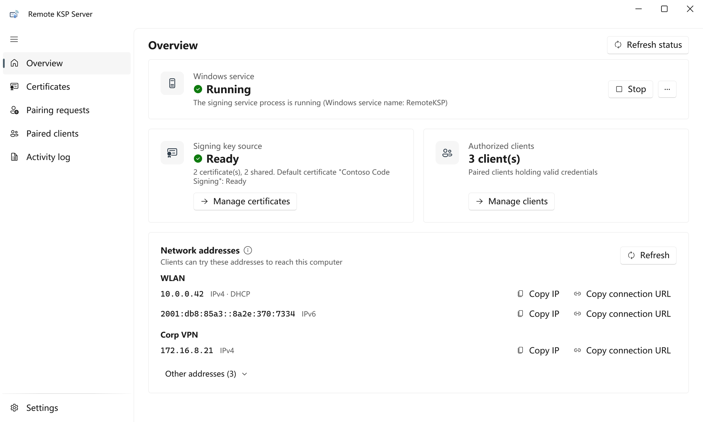
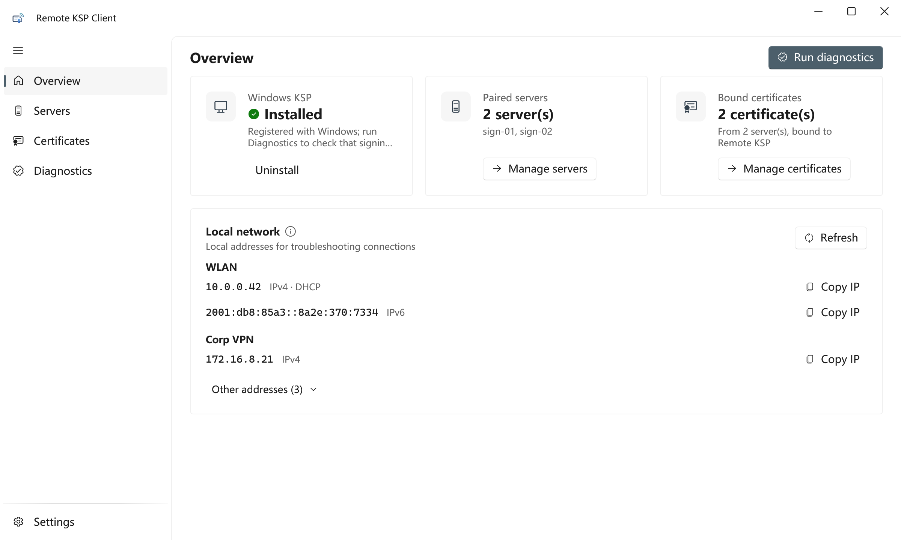

<p align="center">
  
</p>

<h1 align="center">RemoteKSP</h1>

<p align="center">
  在任意 Windows 机器上用证书签名，私钥始终留在签名服务器上。
</p>

<p align="center">
  <a href="../../actions/workflows/ci.yml"></a>
  <a href="../../releases/latest"></a>
  <a href="LICENSE"></a>
  <a href="https://scorecard.dev/viewer/?uri=github.com/Liam-Frost/RemoteKSP"></a>
</p>

<p align="center"><a href="README.md">English</a> · <b>简体中文</b></p>

---

RemoteKSP 是一个 Windows **密钥存储提供程序（KSP）**，把 CNG 签名操作转发到远程服务器。
eToken / HSM 只需插在一台机器上，构建机和工作站与它配对后，`signtool`、MSBuild、Office、
Acrobat 等任何支持 CNG 的程序都能像使用本地证书一样签名，私钥和 token 都不用挪地方。

```
signtool / 任意 CNG 应用
        │  NCryptSignHash
        ▼
RemoteKSP_x64.dll / RemoteKSP_x86.dll   （客户端上的 Native KSP）
        │  HTTPS，固定 TLS 证书指纹，HMAC-SHA256 + nonce
        ▼
RemoteKSP.Server                         （签名机上的 Windows 服务）
        │
        ▼
eToken · 证书存储 · PFX                  （真正的私钥）
```

网络上只传哈希值；签名结果返回后，先在本地用证书公钥验证，再交给调用程序。

## 截图

<table>
  <tr>
    <td width="50%"></td>
    <td width="50%"></td>
  </tr>
  <tr>
    <td align="center"><b>服务端</b>：运行在插着 token 的签名机上</td>
    <td align="center"><b>客户端</b>：运行在构建机和工作站上</td>
  </tr>
</table>

界面语言默认跟随 Windows 显示语言，也可以在设置里切换为简体中文或英文。

## 功能

**服务端**（`RemoteKSP.Server.exe`，以 Windows 服务运行）
- 密钥来源：SafeNet eToken、Windows 证书存储、PFX 文件、只有公钥的测试证书
- 配对需管理员批准，验证码由 TLS 指纹和双方随机数计算，防止假冒服务端
- 按客户端授权可用的证书，随时撤销
- PIN 保护：PIN 错误、token 已锁或返回无法识别的错误时，**只试一次**就停用证书，不会把 token 试锁
- PIN、PFX 密码等用 DPAPI 加密，数据目录只允许 SYSTEM 和 Administrators 访问
- 收到配对请求时发 Windows 通知（服务端 GUI 没开也会提醒），点击直接打开「配对请求」页
- 活动日志、原地升级、自定义 HTTPS 端口、重新生成 TLS 证书

**客户端**（`RemoteKSP.Client.exe`）
- 可配对多个服务端，每个服务端独立凭据、独立固定 TLS 指纹
- 把共享的证书同步到 `LocalMachine\My`，私钥指向 Remote KSP
- 一键安装 / 更新 / 卸载 Native KSP DLL（x64 和 x86）
- 实时显示服务端状态，内置 `signtool` 命令生成器

**Native KSP**（C++，约 25 KB）
- 实现 CNG KSP 接口，支持 PKCS#1 签名，SHA-1/256/384/512
- 发送任何请求头之前先校验服务端证书指纹

两个程序都支持**英文**和**简体中文**界面（设置 → 语言）；没有选择过时跟随 Windows 显示语言（中文 Windows 显示中文，其他显示英文）。

## 系统要求

- Windows 10 / 11 或 Windows Server 2016 及以上（x64）。KSP DLL 同时提供 x64 和 x86，供两种架构的程序使用。
- 两台机器都需要管理员权限（安装服务、注册 KSP、写 `LocalMachine` 证书存储）。
- 使用 eToken 时，服务端需安装 SafeNet Authentication Client。

两个程序都是自包含的单文件 EXE，不需要安装 .NET 运行时。

## 下载与校验

从[最新 Release](../../releases/latest) 下载 `RemoteKSP.Server-<版本>.exe` 和 `RemoteKSP.Client-<版本>.exe`。

项目目前没有发布者证书，**EXE 没有 Authenticode 签名**，首次运行时 SmartScreen 可能提示风险。
请用下面的方法确认下载的文件没有被篡改：

```powershell
# 1. 与同一 Release 里的 SHA256SUMS.txt 比对
Get-FileHash .\RemoteKSP.Server-v2.2.0.exe -Algorithm SHA256

# 2. 或验证构建来源证明（证明文件由本仓库的 GitHub Actions 构建）
gh attestation verify .\RemoteKSP.Server-v2.2.0.exe --repo Liam-Frost/RemoteKSP
```

## 快速开始

### 1. 部署服务端（插着 eToken 的机器）

以管理员身份运行 `RemoteKSP.Server.exe`，在「概览」页点「安装服务」。程序会复制到
`C:\Program Files\RemoteKSP\`，`RemoteKSP` 服务开机自启，监听 HTTPS 8443 端口并自动添加防火墙规则。
也可以用命令行安装：

```powershell
.\RemoteKSP.Server.exe --install-service
.\RemoteKSP.Server.exe --uninstall-service [--remove-data]
```

**升级**：以管理员打开新版本 exe，在「设置 → Windows 服务」点「更新服务程序」，数据和客户端配对不受影响。

然后在「证书管理 → 添加证书」添加证书：

| 来源 | 适用场景 | 说明 |
|---|---|---|
| **eToken** | 硬件 token（推荐） | 先把公钥证书导入 `LocalMachine\My`（`certutil -addstore My 证书.cer`），点「检测 eToken」填入容器名，填写指纹和 PIN。保存前会用 token 做一次测试签名验证 PIN。 |
| **证书存储** | Windows 里已有的软件密钥 | 只列出带可用私钥的证书。 |
| **PFX 文件** | 文件形式的软件密钥 | 复制到数据目录，密码用 DPAPI 加密。 |
| **测试证书** | 试用配对流程 | 只有公钥，用它签名会被拒绝。 |

勾选「分享给客户端」后，配对的客户端才能同步这张证书。

### 2. 配对客户端

1. 以管理员身份运行 `RemoteKSP.Client.exe`，在「概览」页点「安装 KSP」。
2. 「服务端管理 → 添加服务端」：填写服务端地址和端口。
3. 核对两边显示的验证码一致。
4. 服务端管理员在「配对请求」中批准。
5. 共享的证书自动同步到 `LocalMachine\My`。

### 3. 签名

```powershell
signtool sign /sm /sha1 <证书指纹> /fd SHA256 /tr http://timestamp.digicert.com /td SHA256 app.exe
```

`/sm` 表示使用本地计算机存储。客户端「证书管理」页可以生成并直接执行这条命令。
其他支持 CNG 的程序选中这张证书即可。

## 安全模型概要

- **服务端身份**：配对时核对验证码后固定自签名 TLS 证书；之后客户端和 KSP DLL 拒绝其他证书、明文 HTTP 和重定向。
- **请求认证**：每个请求对方法、路径、时间戳、算法、客户端 ID、正文和随机 nonce 计算 HMAC-SHA256；
  时间误差超过 ±5 分钟拒绝，重复 nonce 原子拒绝。
- **授权**：可限制每个客户端能用的证书，随时撤销。
- **静态数据**：PIN、PFX 密码、HMAC 密钥和 TLS 私钥用 DPAPI 加密，存放在只允许 SYSTEM 和
  Administrators 访问的 `C:\ProgramData\RemoteKSP`。

RemoteKSP 面向**受信任的内部网络**设计，不要把服务端端口暴露到公网。
完整说明见 [docs/SECURITY_DESIGN.md](docs/SECURITY_DESIGN.md)；报告漏洞请看 [SECURITY.md](SECURITY.md)。

## 从源码构建

需要 Windows、.NET 10 SDK，以及安装了「使用 C++ 的桌面开发」工作负载的 Visual Studio 2022。

```powershell
.\publish-all.ps1                    # 编译 Native DLL 和两个单文件 EXE，输出到 Publish\
.\publish-all.ps1 -Version 2.2.0     # 把版本号写入 EXE
.\publish-all.ps1 -Test              # 同时编译并运行回归测试
```

开发时用 Visual Studio 打开 `RemoteKSP.sln`。项目结构、测试和发布流程见 [docs/BUILD.md](docs/BUILD.md)。

## 文档

| 文档 | 内容 |
|---|---|
| [docs/BUILD.md](docs/BUILD.md) | 构建、测试、发布（英文） |
| [docs/SECURITY_DESIGN.md](docs/SECURITY_DESIGN.md) | 协议、数据保护、回归测试覆盖范围 |
| [docs/Archive/ETOKEN_PIN_ERROR_CHECK.md](docs/Archive/ETOKEN_PIN_ERROR_CHECK.md) | 验证真实 eToken 的错误码 |
| [CHANGELOG.md](CHANGELOG.md) | 版本历史（英文） |

## 参与贡献

欢迎提交 Issue 和 Pull Request，流程见 [CONTRIBUTING.md](CONTRIBUTING.md)，
参与时请遵守[行为准则](CODE_OF_CONDUCT.md)。提交 PR 前请运行 `.\publish-all.ps1 -Test`；
涉及认证、配对或密钥处理的行为改动，请在 `tests/SecurityRegression` 补充回归检查。
安全问题请按 [SECURITY.md](SECURITY.md) 私下报告，不要公开提 Issue。
界面文字和翻译的说明见 [docs/BUILD.md](docs/BUILD.md#translations)。

## 许可证

[MIT](LICENSE)
